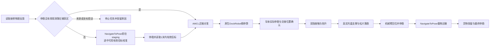

# 固定 SO101 工位与小车运输

控制站 `/cooperation` 使用同一 MuJoCo 世界中的 FishBot、固定 SO101 和一件自由货物。车先到工位附近，再通过选定的ideal／perturbed信标或后向RGB AprilTag进行原生精停靠。机械臂把货物放到车载托盘并退出后，车辆运输到交付点。页面相机来自实际物理世界；合作对话由执行阶段及接触反馈产生。

入口在 `/simulation` 标题旁的“固定工位 · 车臂协同”。协同默认使用独立 ROS domain114，HTTP 端口9086。原巡逻 domain107 与地图规则保持独立。

相机保留上一张已显示图片，新JPEG下载并解码成功后才替换，正常换帧不重建图片节点、不切半透明加载样式。单次下载/解码超过3.5秒时丢弃该请求并读取最新目标，保留旧图片的原时间并明确标记失效；仅排队最新一帧。来源改变或仿真时间回退时，显示层立即隐藏旧图；迟到请求不能覆盖新来源。图片缓冲与任务状态独立，刷新画面不重发任务。后向查看保留32组不可变JPEG/元数据，请求按原episode/sequence读同一帧；过期或已回收时拒绝，不替换成另一帧。

## 再次运行

一轮完成后，货物已在交付点，不能直接再次取货。点击“重置场景”，等待“新回合已就绪”，再点击“开始装货运输”。新回合不会自动启动；任务执行中、取消未完成或终态未知时不能重置。

重置只用于合成仿真。服务先确认本任务线程退出、已派发原生动作终态、停车保持、停靠保护禁用和车臂货物静止。物理执行端独立确认原生状态及0.7秒连续静止，然后在明确的新episode边界恢复编译初态。ROS时钟、编码器累计里程计、物理步数和发布序号不回退；轮角读数基线重新绑定。重新发布初位姿、确认定位并清理原生代价地图后，才开放下一轮。

重置请求带UUID及预期episode；HTTP和ROS回执均绑定原编号。请求超时只核对原记录，不重发重置；查询已确认终态后，迟到POST不得覆盖结果。`start`也绑定当前episode。车速与机械臂参考必须晚于重置源时刻。画面同时绑定场景SHA与episode，并使用每回合独立JPEG；XML SHA仍表示模型，不冒充运行身份。 场景source持续来自启动时已散列的XML，并标明`origin=manifest_world_xml`和`observed`。暂缺新物理帧时保持场景身份，但`physics=null`、`ready=false`；不补造新episode或重置完成。

任务账本与事件归档到运行目录`tasks/history/`，网页展示最近10条服务端历史；旧文件保留。页面刷新不重置场景，也不自动续跑运输。新进程仍禁止直接复用带旧任务账本的输出目录，未知动作不能借重启接管。

## 复用与边界

- 复用 FishBot 原车体、轮惯量、Nav2、速度平滑与 Collision Monitor。
- 复用 SO101 原模型、IK、OMPL、碰撞检查和载荷规划。SO101 checkout 是只读依赖。
- 每次接近规划在独立纯查询子进程中调用原SO101规划器，固定首次seed并保留原路径、逐段碰撞重验和速度。父进程独占任务、停车保持与取消；查询超时或取消只回收本次子进程。规划器不发布ROS动作，也不执行路径简化。实际跟随仍须通过原物理门槛。
- 一件10g货物使用自由关节。执行世界仅在进程初始化或显式新回合边界初始化 `qpos`；活动任务中由执行器、重力和接触推进。没有吸附、任务内传送或跨世界货物复制。
- 薄 ROS 适配发布编码器里程计、激光、关节状态和仿真时钟，并把速度与关节参考交给 MuJoCo 执行器。新世界没有宣称使用 `ros2_control`。
- 近距离精停靠默认使用真值派生的理想仿真信标。P1–P3已接实际RGB/AprilTag与完整有限面板；本轮56例覆盖完整，但11例未通过。各模式与独立物理评分分别判断，没有硬件验收。
- 合成工位、接触材料和位置误差只在仿真验收。没有实车、SO101硬件、策略训练或宇树行走控制验收。

## 启动

需要 ROS2 Jazzy、已构建的本项目 MuJoCo/Nav2 环境，以及含接触规划实现的 SO101 checkout。选择已有 SO101 Python，其中应有 MuJoCo、NumPy、SciPy、OMPL；启动脚本补入系统 PyYAML 和 ROS 包搜索路径。

在项目根准备新回合。输出目录必须不存在，以保留之前的成功和失败证据。

```bash
export FISHBOT_COOP_PYTHON=/path/to/so101-planning/bin/python
./tools/fishbot_cooperation.sh prepare \
  --so101-project /path/to/so101 \
  --output /path/to/new-scene
```

启动生成场景及原生 Nav2。输出目录保存任务账本、逐帧物理状态和实际相机画面。

```bash
FISHBOT_COOP_DOMAIN=114 ./tools/fishbot_cooperation.sh run \
  manifest:=/path/to/new-scene/scene-manifest.json \
  output:=/path/to/new-runtime \
  port:=9086
```

前端 Vite/preview 的 `/coop-api` 默认代理到本机9086。更改端口时，在启动前端前设置 `FISHBOT_COOP_PORT`。原仿真页的域继续由 `VITE_FISHBOT_SIM_DOMAIN` 配置；协同页独立显示114。

## 后向视觉与有限面板

后向相机为640×480、垂直视角55°，安装于base_link(-0.06,0,0.168)。OpenGL像素中心对应OpenCV主点319.5/239.5。工位标记为AprilTag36h11/ID0，黑框0.12m、含留白板宽0.15m。原臂回位几何会遮挡名义中心；实际板横向+0.03m，固定标定同步变化。最终停车点与原车臂碰撞几何不变。

相机快照来自原50Hz源周期，后向渲染墙钟上限20Hz。渲染和检测各保留最新待处理帧。标准Image、CameraInfo和帧身份使用完全相同的源时间；检测的标准SingleThreadedExecutor持续接收，推理单独消费最新帧。PNG保留参与检测的实际像素。系统Python排除规划venv的NumPy，检测节点不订阅车体真值。

OpenCV的IPPE双解与LM只使用实际RGB角点。固定变换为T_base_dock=T_base_camera×T_camera_tag×T_tag_dock。默认采用完整六维解并传播协方差，避免硬平地先验拒绝真实俯仰。检测失败只发布失检；旧帧不重复更新时间。质量分是确定性的图像质量指标，不是任务成功概率。部分遮挡的ID正确仍可能产生错误位姿；本轮不宣称已解决通用遮挡定位。

vision先由原生NavigateToPose与AMCL到达准备点，再由RGB驱动DockRobot。视觉准备点距工位0.65m，为Nav2到达容差保留60px分辨率余量；ideal/perturbed仍为0.70m。每回合派发前使用实际manifest检查完整足迹和扫掠。最终停车要求仍为0.04m、0.05rad、0.7源秒，原保护和清理保留。

`POST /coop-api/start`可选`scope=dock|transport`，默认transport。dock复用相同动作与清理，在机械臂加载前结束，不声称装货。网页显示后向帧、检测框、观测模式、具体拒绝原因和独立报告。图像与框在相同episode/sequence解码后一起更新；过期画面不会标成实时。API新字段保持可选，原114/9086默认兼容；实验页5180独立绑定120/9090。

预声明面板与串行验收入口为`tools/cooperation_acceptance.py`。面板包含6基线、24条件、8故障、12RGB短停靠和6完整运输。阈值只从三个开发基线确定，留出不调参；同控制器parent/candidate仅称复现。观测质量、同UUID原生终态、独立物理评分和保护介入分别报告。失败、unknown、采样缺口与额外调试尝试完整保留。当前实际进度回源[视觉计划progress](../plans/visual-docking-robustness-20261014/progress.md)。

## 任务确认

停靠前通过独立 ROS Bool `/cooperation/docking_guard` 启用执行端停车平面保护。桥接器收到当前场景的新鲜使能回执后才释放车辆保持。仿真执行端在500Hz读取实际车体原点；沿程到停车平面剩余不超过0.01m时锁存，仅把轮速度执行器目标归零，接触、惯性及重力继续积分。该保护属于理想 plant 观测，不代表硬件停靠传感已实现。

原生停靠成功仍必须单独确认。保护触发后2秒未获成功回执，任务取消并报失败；保护停车不会伪造成功。正常退场先确认原生终态、实际车体保持与停稳，再发送禁用保护，等待源时间更新的禁用回执后才继续。清理也必须确认禁用，超时保留unknown与车辆保持。原生停靠自动重试为0，当前合作不派发UndockRobot；该参数组合不能外推到其他停靠模式。

## 工位观测合同

准备器将 `station_perception` 固定到 manifest。`ideal` 是原默认观测；`perturbed` 声明噪声、偏差、丢检概率、seed和回合相对时间遮挡；`vision` 要求独立发布者、置信度与方差上界。vision由独立系统Python/OpenCV4.6检测真实后向RGB；物理节点不创建真值观测发布者，也不回退ideal。

生产器使用 `/cooperation/station_pose` 的 `PoseWithCovarianceStamped` 和 `/cooperation/station_detection` 的 `DiagnosticArray`。两者使用同一源时间和 `base_footprint`；桥接器复用 Exact TimeSynchronizer，并在转发前校验工位、scene/manifest/episode、序号、来源和协方差。只有本桥发布 `/detected_dock_pose`，原生停靠继续消费 `PoseStamped`。

失检只发布诊断，不给旧位姿换时间。最新检测和拒绝原因在API的 `station_perception` 字段中保留；迟到失检不能覆盖更新观测。范围1m、源龄−0.1至0.25s、接收龄0.5s保持。ideal/perturbed仍核对物理信标来源；vision不从物理真值计算检测，但交接安全条件与机械臂碰撞查询继续使用披露的物理反馈。

工位观测复用50Hz源时间状态周期，每周期读取一次当前物理快照并在扫描前发布；scan仍为10Hz。低实时因子会放大源周期的墙钟间隔，因此不能把10Hz源频率当作10Hz接收频率。状态读取只读已采样缓存，不额外推进随机数或改动世界。

ideal保留原AMCL协方差0.0001；perturbed将相对协方差按定位变换传播到map。vision保留AMCL激光地图定位，不用远处PnP反复重置AMCL；RGB位姿只作为原生Dock目标，其完整六维协方差按固定标定传播到平面观测。置信度与方差门槛在20帧静态预检后冻结；不同模式不能改字段冒充真实视觉。

在新的场景输出中声明受扰条件；参数与面板由当前计划冻结。

```bash
./tools/fishbot_cooperation.sh prepare \
  --so101-project /path/to/so101 --output /path/to/new-scene \
  --perception-config /path/to/declared-perception.json
```



每一步读取新鲜物理反馈。抓取要求抬升至少25mm、双指各超过0.02N并持续1秒。释放要求托盘实际支撑、低指力和低相对速度持续1秒。车辆只能在机械臂实际回位并停稳后启动。完成要求同一货物实际运输至少0.5m、仍在托盘、车体与货物停稳。

运输留盘复用放稳检查中的旋转货物外廓，保留原中心范围和真实支撑要求。不能仅凭中心在盘内判定安全；货物转动后，任一角点越过内壁均拒绝继续。装货交接与最终完成同时要求车保持停车、实际停稳、机械臂回位并停稳、货物仍在盘内且放稳；运输期间持续复验机械臂状态。原连续1秒、原接触门槛与实际位移0.5m要求保持。

共享执行栈与候选补丁评审见[配对验收](STACK_IMPROVEMENT.md)。补丁门禁只读取仿真报告，不发布车速、锁车或自动应用版本。

规划克隆冻结实际停止车辆的全部几何。克隆中的 `qpos` 查询不会移动执行世界。夹爪压力、原1mm碰撞余量和0.2mm载荷余量保持。

机械臂轨迹插值、段持续时间与额外20秒收敛预算统一使用仿真源时间。仿真低于实时速度时，墙钟不能提前判定物理轨迹未收敛。原0.012rad关节误差、0.05rad/s速度门槛和通信新鲜度保持；整项任务仍有独立360秒墙钟上限。未收敛提示包含段名、具体关节、残差和仿真时间。

编码器先独立积分轮轴中心，再按编译模型固定偏移变换到base_footprint。原车轴中心为 `(-0.02,0,0.032)`，原地转向会移动车体原点；发布位置与twist包括这个刚体偏移。没有用真值修正编码器漂移或改动模型原点。

物理状态同时发布完整 `qpos22`、`qvel20`、八个执行器的 `ctrl` 和 `time_s`，供独立规划克隆读取。车体、货物和托盘的速度使用 `mjOBJ_XBODY`，对应 `xpos` 所表示的刚体坐标原点。货物相对托盘速度包含该原点到货物位置的角速度项。

执行世界保持500Hz积分。物理状态和clock采用标准SensorQoS的BEST_EFFORT、VOLATILE、KEEP_LAST1；订阅保持同语义，过期状态仍拒绝。逐阶段计时与最多32条慢事件只记录观测，不参与控制。每次50Hz状态发布前，`mj_forward` 刷新派生位姿、传感器和当前接触，不推进仿真时间或改写位置、速度与命令。当前接触与500Hz步骤累计计数分别记录。

前端先创建任务UUID，再显式提交一次。`unknown` 只读取同一任务，不自动重发。每个 Nav2 请求分别持有原生目标及结果；晚到接受回执会取消对应目标，不能借其他目标的终态释放控制权。取消只有在该目标终态与连续物理静止均确认后才显示 `canceled`。

如果6秒清理窗口内未确认原生终态与物理静止，任务保持 `unknown`。后续 GET 只读取原记录；迟到目标后来结束，也不会自动重新评分、改判任务终态或解锁控制权。当前网页没有人工对账解锁入口。

首版恢复入口是显式结束旧 runtime，并确认其原生执行与物理世界已停止。保留旧任务账本和失败证据，再用新场景目录与新运行目录创建独立 episode。启动器和独立桥接入口在创建控制发布者前拒绝已有任务账本，包括损坏账本；拒绝启动不证明旧执行已停止。新 episode 初始化新货物，旧记录继续保留；重发旧 UUID 或清除前端 `sessionStorage` 不构成原任务恢复。

首版每个合成回合运输一次。成功后货物留在交付点，开始按钮禁用并提示需要新回合。启动新的空闲世界会初始化新货物；当前任务内不会把货物传送回取货盘。

## 近距离定位与原生停靠

桥接器先读取新鲜工位观测。车辆已停稳，且位于最终停车朝向前侧0.2–0.9m、侧向偏差不超过0.06m、朝向偏差不超过0.15rad时，直接进入原生停靠捕获区。其他位置显式派发 `NavigateToPose` 到 manifest 的 `staging_pose`。默认场景的 staging 是 `(-1.1, -1.8, 0)`，机器人停靠目标是 `(-1.8, -1.8, 0)`。机器人停稳后，桥接器读取工位相对观测并等待 AMCL 近端定位对准。

物理驱动复用已有相对信标数学，在距离工位不超过1米时发布10Hz `/detected_dock_pose`。消息使用 `base_footprint` 坐标系与原始仿真源时间戳。相对观测由当前物理车体真值和 manifest 中的固定工位姿态计算；来源绑定场景与 manifest SHA。

桥接器校验唯一物理发布者、来源、范围和新鲜度。它把相对观测与已知工位地图姿态组合，向原生 AMCL 发布 `/initialpose`，保留信标原时间戳。前往staging的导航阶段一旦收到有效范围内的新鲜观测，即按原源时间辅助近端定位；范围外、未收到或过期的可选观测不更新AMCL。来源或坐标系错误仍拒绝。进入精停靠前执行一次停稳对准；`DockRobot` 运行期间必须持续获得有效新观测，继续修正近端定位。该校准不修改物理车体 `qpos`。

随后派发原生 `DockRobot`，使用 `opennav_docking::SimpleNonChargingDock`。`navigate_to_staging_pose=false` 保留前述独立导航目标；`dock_backwards=true` 对应从东侧直线倒入工位。原生 dock 坐标系朝向与最终机器人朝向相反，二者共享同一个停车位置。

停靠控制继续使用完整局部足迹和碰撞检测，`projection_time=1`、半径与 padding 保持。原生 1.3.13 [DockingServer](https://github.com/ros-navigation/navigation2/blob/1.3.13/nav2_docking/opennav_docking/src/docking_server.cpp)把控制目标外推到真实停靠点之后 0.25m；[Controller](https://github.com/ros-navigation/navigation2/blob/1.3.13/nav2_docking/opennav_docking/src/controller.cpp)按到这个虚拟目标的距离判断 `dock_collision_threshold`。因此设置0.25m：真实停靠点之前，包括插件2cm停车范围的入口，仍检查完整足迹；真实停靠点之后的不可执行预测段才被排除。原先0会把继续驶过工位的预测当成实际进站路径，I回合因此失败；失败记录保留，不能重算成成功。

同一个阈值还会跳过原生 reset/undock 路径的起始段。为保留实际运动的检查边界，本合作设置 `max_retries=0`，原生停靠失败即停止并返回失败，不执行 `resetApproach`。当前流程只调用 `DockRobot` approach，车辆离站由原生 Nav2 执行；`UndockRobot` 不列为本合作的验收支持。原生停靠成功后，桥接器仍检查实际交接位置、朝向与连续停车反馈，再允许机械臂抓取；Collision Monitor 和独立物理接触门槛继续生效。

上述证明限定碰撞检查的几何范围。[SimpleNonChargingDock](https://github.com/ros-navigation/navigation2/blob/1.3.13/nav2_docking/opennav_docking/src/simple_non_charging_dock.cpp)只按欧氏距离判断是否停靠；侧向误差过大时，它可能越过真实停靠平面而未命中2cm停车范围。因此实际执行启用前述500Hz plant 保护，读取实际车体原点并在平面前1cm将轮速度目标归零。原生未确认成功时取消并返回失败。接触与惯性仍正常积分，实际轨迹和停止余量须独立核对；该保护没有硬件验收。

上述语义对应 Nav2 tag `1.3.13` 原始文件：`docking_server.cpp` SHA256 `9401e8fec77668e4d4ed3fd44707d4a423b350d45422ad59700b807279ef81ac`，`controller.cpp` SHA256 `8ff965a3dfd3ead0e576bab4b1d71a26cf494c36fbd8e9aea5fa7e7988d4e8bc`。准备器读取实际安装包版本；其他版本明确拒绝，要求重新验证目标与阈值语义。场景 manifest 记录原始来源与哈希。回归使用实际编译场景的碰撞栅格和完整 padding 足迹，按5mm步长验证真实停靠点之前没有 lethal overlap，停靠点之后的虚拟段确实碰到工位结构。

当前近端定位与停靠默认属于理想仿真传感器辅助。页面实际相机用于观察；本轮未接入 RGB 或 AprilTag 识别。默认ideal没有噪声、遮挡或丢检；P0受扰配置只表示合成传感器条件，完整对照与真实视觉另行验收。

## 定位图与避障图

准备器从同一世界生成两张图。AMCL读取真实激光高度的几何切片；Nav2两张costmap通过第二个原生MapServer读取完整高度的碰撞投影。低台面不出现在定位图，仍出现在避障图。

车体停靠目标在机械臂坐标中为 `(0.20, 0.20)`，托盘相对车体偏移为 `(0.04, -0.06, 0.067)`。绝对交接中心仍为机械臂坐标 `(0.24, 0.14)`。场景 manifest 输出 `base_footprint` 帧完整凸包，两张 costmap 使用相同非空足迹。

凸包保留原半径0.13m圆外廓，并加入编译后托盘底与四面壁的全部角点。32边外切包络保留圆点之间的原半径；现有 `footprint_padding` 保持0.01m。新工位几何调整没有缩小车体范围，也没有关闭碰撞检查。

首轮完整任务停在工位最后转向。独立212束重算排除了明显laser/TF错误，原地图却把低台面作为激光墙：一束2.512m实际回波在地图中提前到0.364m。切片修复恢复该回波；其他离散边缘误差仍存在。地图不一致得到证实，但不能单凭它宣称解释全部定位误差。实际停靠和运输须另行验证。

第二轮只修地图仍失败。原 `likelihood_field` 对真值与10.63cm错位估计的得分优势只有约3.54%。按[Nav2 1.3.13概率模型](https://github.com/ros-navigation/navigation2/blob/1.3.13/nav2_amcl/src/sensors/laser/likelihood_field_model_prob.cpp)及本机原生距离场重放，`likelihood_field_prob` 能区分错位。协同场景选180束、`sigma_hit=0.05`、`z_hit=0.95`、`z_rand=0.05`，更新间隔为0.01m/0.01rad，未启用beam skipping。8种配置及1521个局部位姿的最佳匹配距真值2.83cm，朝向一致；这是离线依据，实际收敛另行验收。

这些测量设置针对当前理想化激光和2cm合成栅格。AMCL运动噪声与交接物理门槛保持。当前实现已接入[Nav2原生停靠](https://docs.nav2.org/jazzy/tutorials/general_tutorials/using_docking/)和上述真值派生相对信标；近端校准结果应按该传感器边界解释。

准备器复用项目的官方行为树组合，路径有效时保持，目标改变或原生IsPathValid失败时重算；原控制与恢复节点保持。

准备器采用已安装的 `nav2_controller::PoseProgressChecker`，将旋转进展门槛设为0.1rad。原 `required_movement_radius=0.15m` 和 `movement_time_allowance=10s` 保持。取消后重新导航需要先转向时，原生进度检查可识别该旋转；没有删除进度检查或放宽其距离与时间门槛。

## 验证

普通反馈检查包含纯逻辑与任务所有权回归。

```bash
./fishbot.sh check-feedback
```

在已有 SO101 环境验证场景和物理适配；缺依赖不能算通过。

```bash
FISHBOT_SO101_PYTHON="$FISHBOT_COOP_PYTHON" \
  "$FISHBOT_COOP_PYTHON" -B -m unittest \
  tools.tests.test_cooperation_scene tools.tests.test_cooperation_sim
```

完整网页与原生验收须核对 DDS 物理状态、实际 `/clock`、`NavigateToPose` 与 `DockRobot` 终态及相机来源。静止工位探针与单元测试不能代替车辆停靠后的完整运输。

2026-10-14 的 K 回合通过独立原生与物理验收。网页先取消实际运动中的原生停靠，同UUID到CANCELED，车臂连续静止1.10秒；随后同一世界执行新任务，原生停靠和载物导航均到SUCCEEDED。货物实际抬升约40.9mm并保持双指接触，松爪后实际托盘支撑与完整货物外廓留盘；机械臂先回位并静止1秒，车辆才启动。同一货物实际运输1.790841m，车货最终静止1秒，非预期接触与留盘违规均为0。

独立物理记录12635帧，源时间最大间隔20ms、序号无缺失，车体和货物分别与独立ROS真值核对。墙钟接收最大间隔339.739ms仍保留；本轮不宣称连续墙钟无孔洞。停车平面最小采样余量14.214mm，正常原生停靠在保护触发前成功；保护触发的动态验收归属独立物理回归，不能编成本轮被触发。

桌面入口、实际960px相机、390px手机、完成页与只读刷新通过。完整流程只有两次显式start和一次同任务cancel，无页面异常或自动重发。K的执行源码10项SHA在采集前后均一致；完整运输之后，只修正禁用超时后cleanup漏验实际ACK的异常分支，正常轨迹、物理和Nav2参数未改。两条对应负例与当前36项编排回归通过；不把K的源码哈希冒充这次异常修复后的哈希。

当时的本机验收资料位于 `~/.cache/fishbot/cooperation/session-20261014/`，含 `ui-k-result.json`、`oracle/run-1791919665149152720/score-1791920037922113535.json`、`oracle/k-native-guard-end-proof.json` 和 `runtime-k/accepted-source/`。2026-10-17检查时该session目录已清理，不再保证这些本机原件可读。历史结论与当时的来源、失败和检查记录见[任务进度](../plans/fishbot-so101-cooperation-20261014/progress.md)；本轮没有重新执行K运输，也没有把清理当作重新验收。

## 显式运行选项

manifest 可设置 `render_overview: false`，跳过概览相机渲染。
`frame-dir` 保留，后向 RGB 相机和检测路径独立运行。默认仍渲染概览。

`queued_ros_dispatch: true` 让标准 SingleThreadedExecutor 在后台接收 ROS。
命令、hold、guard、reset 和 MuJoCo 状态仍由原物理线程统一应用。
底盘命令保存首次回调接收的单调时刻，排队不会刷新看门狗。
默认仍在物理循环内分发。直接运行 sim 的对应参数为
`--no-overview-render`、`--queued-ros-dispatch`。
timing 报告记录 `ros_dispatch` 模式和 `command_apply` 阶段。

原生 velocity_smoother 的仿真时钟选项需要独立 overlay，见
[Nav2 补丁与原生对照](../tools/patches/README.md)。
速度、加减速、碰撞、载货及任务评分分别验收；短测实时率不代表运输通过。

## 日志与容量

演示启动默认 `record_state:=false`，不创建 `physics.jsonl`。物理/ROS状态仍按原周期发布，独立评分合同不变。任务完成或关闭网页不结束仿真进程，因此不能依赖页面生命周期停止磁盘日志。需要排障时显式启用：

```bash
FISHBOT_COOP_DOMAIN=120 ./tools/fishbot_cooperation.sh run \
  manifest:=/path/to/scene-manifest.json output:=/path/to/new-runtime \
  domain:=120 port:=9090 record_state:=true
```

滚动诊断默认墙钟2Hz、每片8MiB、3个备份加当前片，合计最多32MiB。配置项为 `state_log_hz`、`state_log_max_bytes`、`state_log_backups`；直接运行sim使用对应 `--state-log-*`。频率0.1–50Hz、单片1KiB–64MiB、备份1–7；不能用0备份关闭轮转上限。复用Python标准RotatingFileHandler，不覆盖预先存在的日志/分片；本次滚动旧片可被覆盖，原始stamp与sequence不改。限频不追赶旧帧。单条超限、磁盘满或写/flush错误会停止该诊断写入，通过ROS状态和最终timing报告显示首错，物理循环继续。原record_flush阶段不再单独测量，标准库emit内的flush计入record_write，报告明确标记。

滚动诊断始终标记 `complete_evidence=false`，不能用于完整评分。独立observer不轮转、不主动抽样；按实际manifest内容保留首份完整身份，后续只去掉重复manifest并记录引用摘要，其余source、时间、序号与动态观测保持。默认 `--duration 900 --max-record-bytes 1073741824`，最长900秒，预算可设1KiB–4GiB；到期正常结束，字节超限或IO失败立即结束采集并保留已有行。`collection-end.json`报告写入计数、字节、不完整原因与关闭结果。这里的capture_complete表示收到的每条offer均写入并成功关闭，不证明DDS源序列无缺口，原序列/双时钟/物理评分仍独立执行。

新采集在source-start声明预算。预算/IO/关闭失败、缺少最终元数据或HTTP线程未退出，都生成正式失败报告；可能存在半行JSON时先拒绝验收，不解析尾部冒充物理评分。四个最终验收声明随失败统一为false。旧离线记录未声明预算时标记legacy_budget_not_declared，不伪称已验证新上限。原物理与时间门槛保持。

上述32MiB只约束物理诊断文件，不是整个实验目录的上限。RGB素材、相机/检测日志与独立证据各有用途，本轮不删除其历史文件，也不把滚动诊断替代这些材料。当前运行证据、抽样估算和源冻结见[容量修复进度](../plans/cooperation-log-budget-20261017/progress.md)。

## 下一步

[视觉停靠鲁棒性计划](../plans/visual-docking-robustness-20261014/task_plan.md)已执行50短回合和6运输。34短停靠完成、7正确取消、9短失败；运输ideal1/2、perturbed2/2、vision1/2。整体验收未通过，11失败、83原result与额外尝试全部保留。AMCL接近、实际RGB驱动Dock、独立物理门槛保持；后续只用新开发输出调查偏航持续停稳、时龄与RGB可见性，不用本轮留出调参。详见计划progress。

## 独立评分入口

原K数学/采样/评分已迁入 `tools/cooperation_oracle_base.py`；`tools/cooperation_oracle.py` 保留episode、原生UUID、reset与完整交接/携货检查。它只订阅与HTTP GET，不控制、取消或重置任务。评分与执行端代码分开，原始缓存和失败保持。

观察必须指定新输出、当前episode、预声明markers及独立domain；0/107/114拒绝。使用已有ROS/Python环境，避免直接启动缺系统依赖的venv。

```bash
FISHBOT_COOP_DOMAIN=120 ./tools/fishbot_cooperation.sh oracle \
  --domain 120 --api http://127.0.0.1:9090/coop-api \
  --expected-episode UUID --allow-initial-episode \
  --markers /path/to/declared-markers.json --output /path/to/new-observer \
  --duration 700
```

离线重放使用 `--score-only /path/to/old-observer`，结果必须写入新的外部目录，不改旧记录。`offline_replay`不等于本轮ROS验收；`live_observation`仍要核对完整原生/物理评分、外部执行源冻结与清理。当前stack-gate只消费导航报告，不直接消费此结果。
